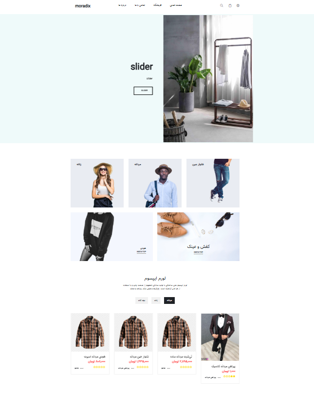
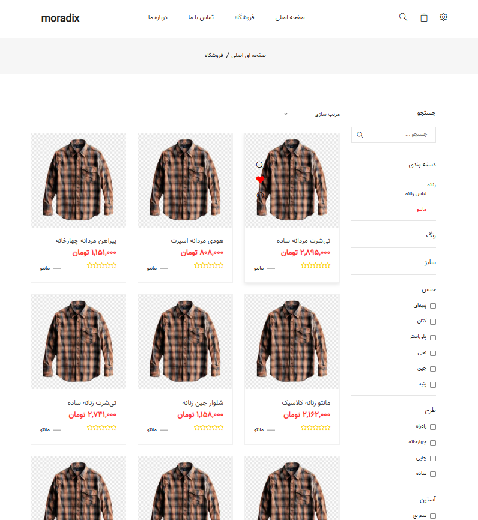
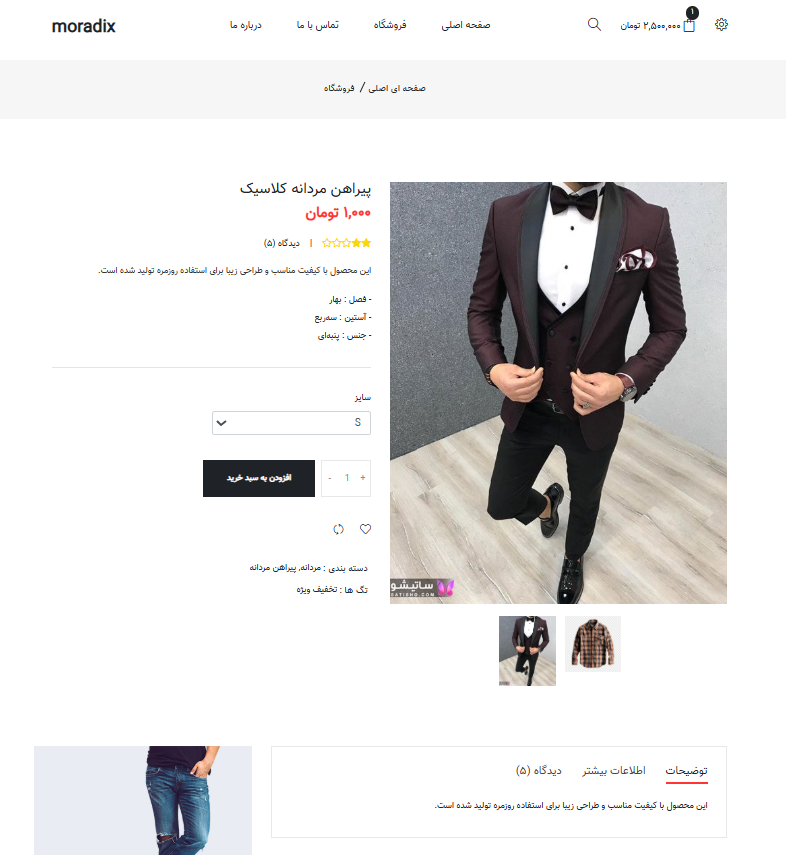
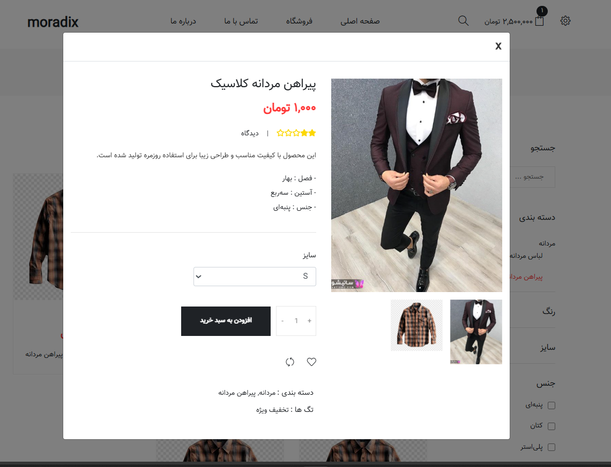
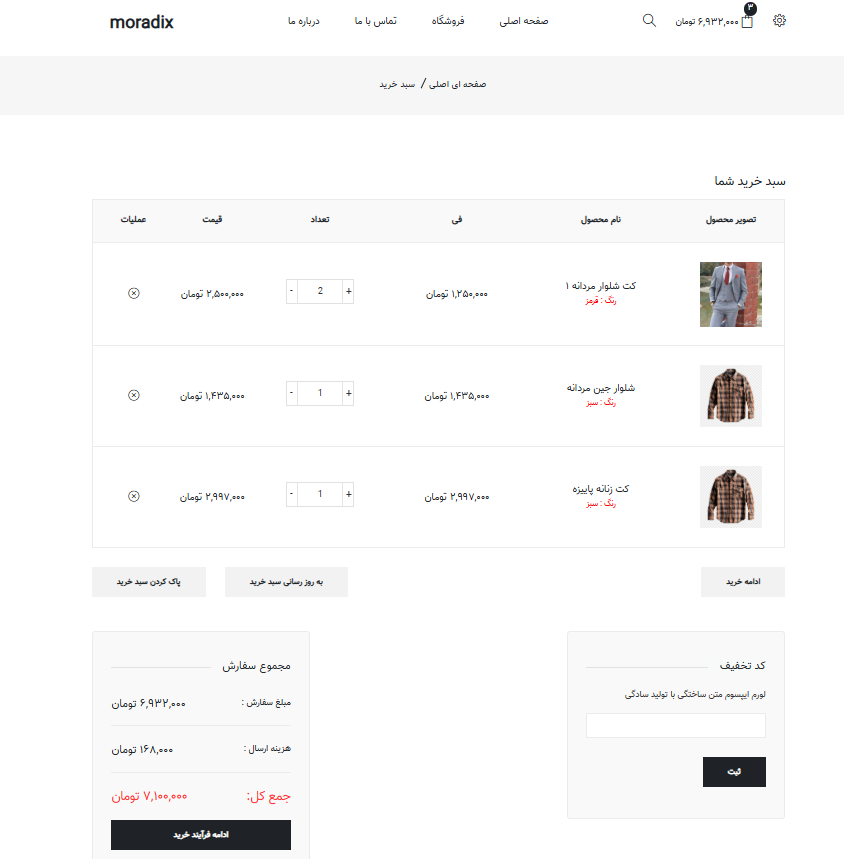
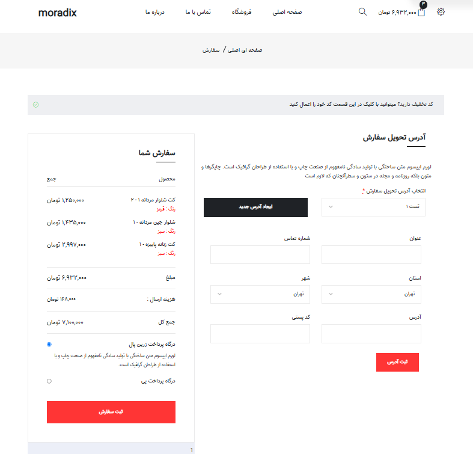
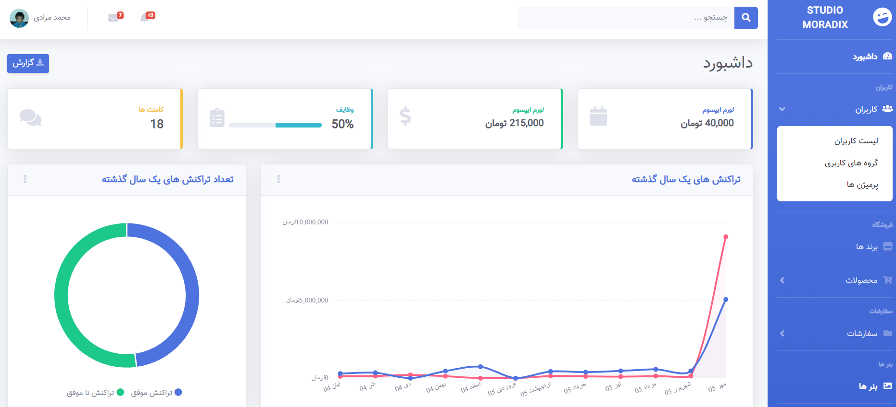
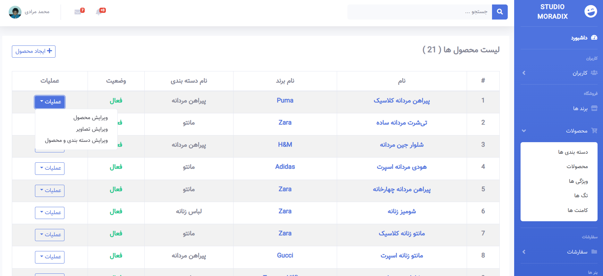
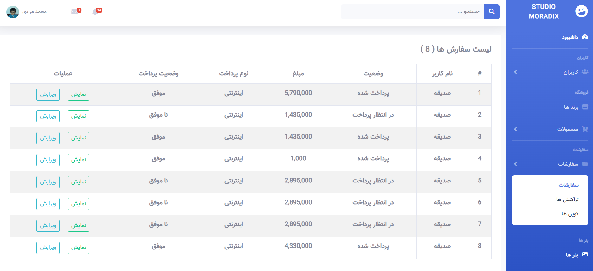

# 🛍️ فروشگاه اینترنتی پوشاک | Laravel eCommerce

یک فروشگاه اینترنتی پوشاک توسعه‌یافته با Laravel، شامل امکانات خرید آنلاین، مدیریت محصولات متغیر، پرداخت اینترنتی و پنل مدیریت.

## 📸 تصاویر پروژه

### 🏠 صفحه اصلی

### 🗂️ دسته‌بندی محصولات

### 👕 جزئیات محصول

### 👀 مشاهده سریع محصول

### 🛒 سبد خرید

### 💳 تسویه‌حساب

---

## ✨ امکانات فروشگاه

### 🛍️ امکانات کاربران

- صفحه اصلی شامل بنرهای تبلیغاتی و دسته‌بندی محصولات
- نمایش اسلایدی محصولات تخفیف‌دار
- جستجو و مرتب‌سازی محصولات
- فیلتر محصولات بر اساس رنگ، سایز، جنس و سایر ویژگی‌ها
- مشاهده سریع محصولات
- انتخاب ویژگی متغیر محصول مانند سایز یا رنگ
- نمایش قیمت و تخفیف هر گزینه
- افزودن محصولات به سبد خرید و تعیین تعداد
- فهرست علاقه‌مندی‌ها و مقایسه محصولات
- نمایش امتیاز و نظرات محصولات
- ثبت نظر توسط کاربران
- ثبت‌نام و ورود کاربران
- ورود با حساب گوگل
- پروفایل کاربری
- مشاهده سفارش‌ها و مدیریت آدرس‌ها
- مشاهده علاقه‌مندی‌ها و نظرات ثبت‌شده
- صفحات درباره ما و تماس با ما
- فرم ارسال پیام

### 🛒 سبد خرید و سفارش‌ها

- نمایش تصویر، نام، تعداد، قیمت و ویژگی انتخاب‌شده محصول
- به‌روزرسانی تعداد محصولات
- حذف محصول یا پاک‌کردن سبد خرید
- ثبت و اعتبارسنجی کد تخفیف و کوپن
- محاسبه مبلغ سفارش، تخفیف و جمع کل
- انتخاب یا ثبت آدرس در مرحله تسویه‌حساب
- ثبت سفارش و نمایش جزئیات آن
- اتصال به درگاه پرداخت زرین‌پال
- نمایش تعداد، قیمت، تخفیف و مبلغ نهایی سفارش

## 🖥️ پنل مدیریت

### 📊 داشبورد
- نمایش آمار و اطلاعات کلی فروشگاه
- نمایش تعداد تراکنش‌ها و نظرات
- دسترسی به بخش‌های مدیریتی

### 👥 مدیریت کاربران و دسترسی‌ها
- مشاهده و مدیریت کاربران
- مدیریت نقش‌ها و گروه‌های کاربری
- تعریف و مدیریت مجوزهای دسترسی
- کنترل دسترسی مدیران

### 📦 مدیریت محتوای فروشگاه
- مدیریت برندها
- مدیریت بنرها
- مدیریت دسته‌بندی‌ها
- مدیریت محصولات و ویژگی‌ها
- مدیریت برچسب‌ها
- مدیریت نظرات کاربران

### 📋 مدیریت سفارش‌ها و پرداخت‌ها
- مشاهده و مدیریت سفارش‌ها
- مشاهده و مدیریت تراکنش‌ها
- مدیریت کوپن‌ها و کدهای تخفیف

عملیات ایجاد، مشاهده، ویرایش و حذف (CRUD) برای بخش‌های مدیریتی مربوطه پیاده‌سازی شده است.

### 📦 مدیریت محصولات

### 📋 مدیریت سفارش‌ها

---

## 🧰 تکنولوژی‌ها و ابزارها

### Backend
- PHP
- Laravel 12
- Composer

### Frontend
- HTML
- CSS و Sass
- JavaScript
- Bootstrap 4
- jQuery
- Laravel Mix
- Axios
- Chart.js
- SweetAlert

### پکیج‌ها و کتابخانه‌های مهم

| پکیج | کاربرد |
|---|---|
| Laravel Fortify | احراز هویت |
| Laravel Socialite | ورود با حساب گوگل |
| darryldecode/cart | مدیریت سبد خرید |
| cviebrock/eloquent-sluggable | تولید اسلاگ |
| anetwork/validation | اعتبارسنجی فارسی |
| Hekmatinasser Verta | مدیریت تاریخ شمسی |
| Spatie Laravel Permission | مدیریت نقش‌ها و مجوزها |
| Shetabit Payment | یکپارچه‌سازی درگاه پرداخت |
| Ghasedak SMS و SMS.ir | سرویس‌های پیامکی |
| Artesaos SEOTools | ابزارهای سئو |
| SweetAlert | نمایش پیام‌ها و اعلان‌ها |
| Bootstrap Select | بهبود انتخاب گزینه‌ها |
| Jalali Datepicker | انتخاب تاریخ شمسی |
| Laravel Google reCAPTCHA v3 | محافظت در برابر درخواست‌های خودکار |

---

## 🚀 نصب و راه‌اندازی

### پیش‌نیازها
- PHP سازگار با Laravel 12
- Composer
- MySQL یا پایگاه داده سازگار
- Node.js و npm
- Git

**## 🗄️ راه‌اندازی دیتابیس**

ابتدا یک دیتابیس جدید در MySQL با نام دلخواه ایجاد کنید.

سپس فایل `database/database.sql` را از پروژه دریافت کرده و در MySQL Workbench از مسیر زیر آن را Import کنید:

`Server → Data Import`

گزینه `Import from Self-Contained File` را انتخاب کرده و فایل `database/database.sql` را معرفی کنید.

دیتابیس مقصد را انتخاب کرده و روی `Start Import` کلیک کنید.

در پایان، اطلاعات اتصال دیتابیس را در فایل `.env` وارد کنید.